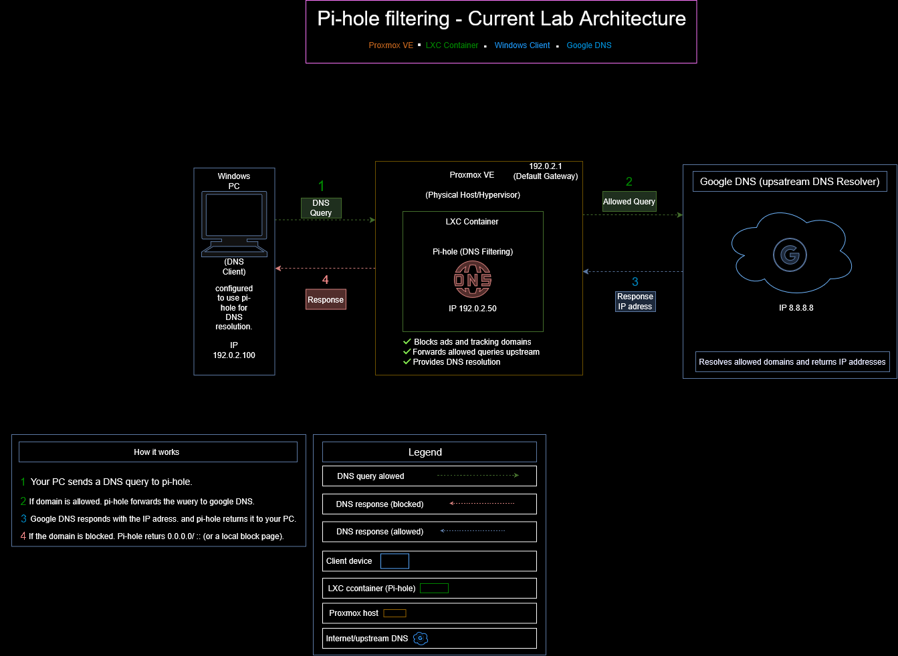
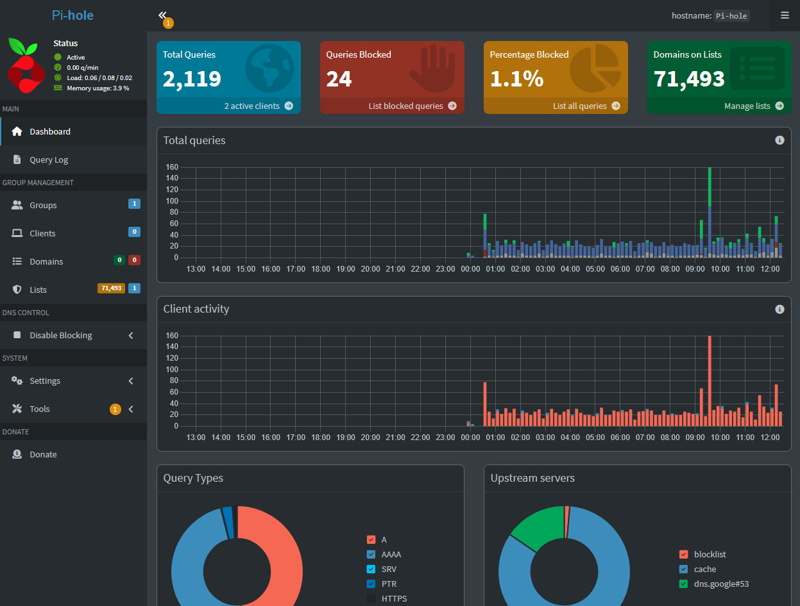
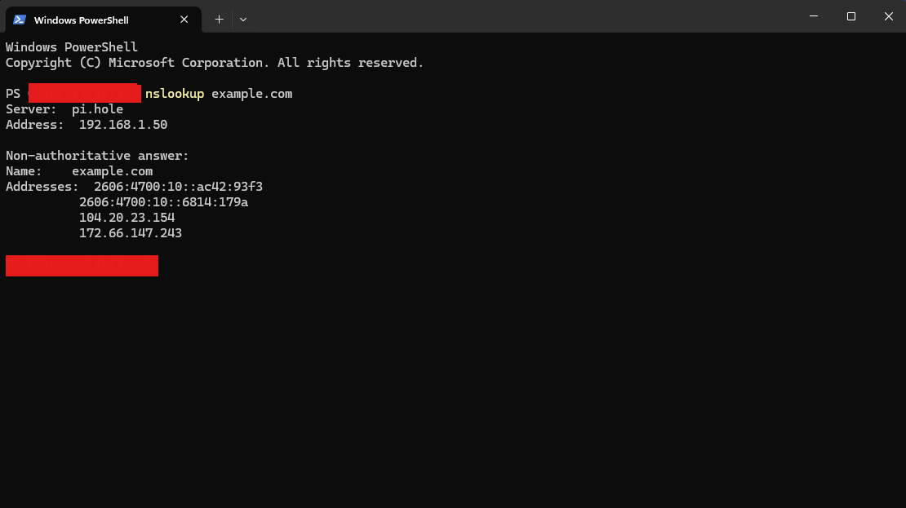
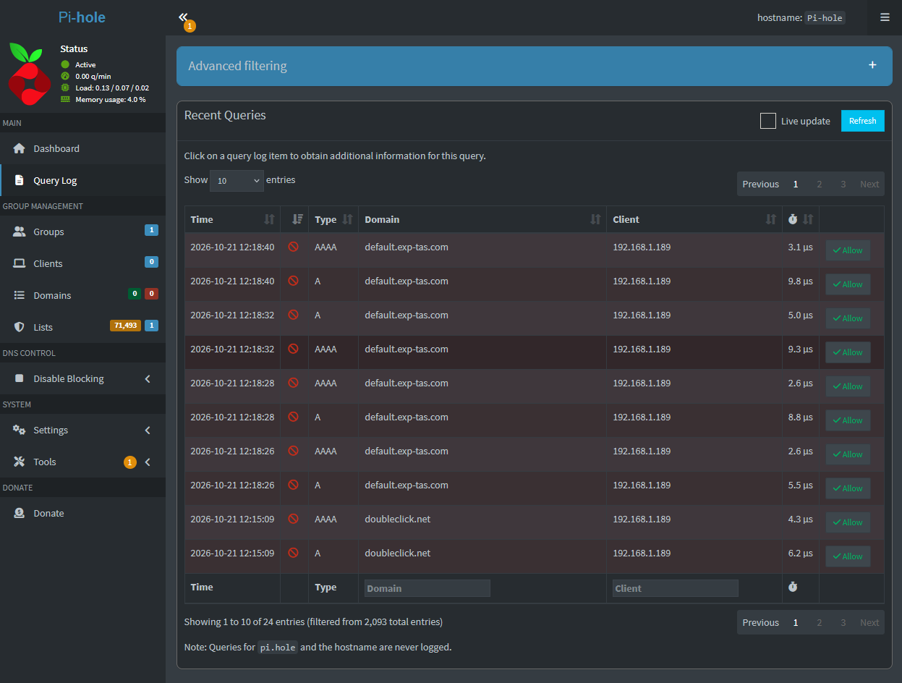

# Pi-hole DNS Filtering on Proxmox

A hands-on homelab project deploying Pi-hole in a Proxmox VE Linux container to provide DNS-based domain blocking and filtering for a Windows client.

## Project Overview

The goal of this project was to deploy a network-level DNS filtering service, configure a Windows client to use it, and verify that DNS resolution and domain blocking worked as expected.

This project provided a lot of great hands on learning with Linux services, virtualization, DNS configuration, network troubleshooting, and technical documentation.

## Lab Environment

| Component               | Description               |
| ----------------------- | ------------------------- |
| Virtualization platform | Proxmox VE                |
| DNS filtering service   | Pi-hole                   |
| Deployment method       | Linux LXC container       |
| Client operating system | Windows                   |
| DNS upstream provider   | Google Public DNS         |
| Testing tools           | PowerShell and `nslookup` |

*Network addresses are omitted from this overview to keep the configuration documentation portable.*

## Network Architecture

The lab consists of a Windows client connected to a local network, with DNS requests directed to Pi-hole running in a Proxmox LXC container.

The DNS request flow is:

1. The Windows client requests an IP address for a domain.
2. The request is sent to Pi-hole.
3. Pi-hole checks the requested domain against its filtering lists.
4. Allowed requests are resolved through the configured upstream DNS provider.
5. Blocked requests receive a blocking response instead of a normal destination address.

## Implementation

### 1. Deploy Pi-hole

- Deployed Pi-hole in a Linux LXC container on Proxmox VE.
- Configured the container for use as a local DNS filtering service.
- Accessed the Pi-hole administration interface through a web browser.

### 2. Configure the Windows Client

- Configured the Windows client to use Pi-hole as its DNS resolver.
- Verified the configured DNS server using PowerShell.
- Used `nslookup` to test domain resolution and filtering behavior.

### 3. Test DNS Filtering

- Tested a standard domain to verify that normal DNS resolution continued to work.
- Queried an advertising-related domain to test Pi-hole's blocking behavior.
- Inspected Pi-hole's Query Log to review DNS requests from the Windows client.

## Validation and Testing

### Pi-hole Dashboard

The dashboard provides visibility into DNS activity and filtering statistics.

### Successful DNS Resolution

Ran `nslookup example.com` from Windows PowerShell. The output identified Pi-hole as the DNS server and returned IP addresses for the requested domain.

### Blocked-Domain Test

Ran `nslookup doubleclick.net` to test domain filtering. The query returned `0.0.0.0` and `::`, consistent with Pi-hole's blocking response. The Query Log was also used to inspect the corresponding DNS request and its blocking status.

### Validation Results

| Test                             | Result                               |
| -------------------------------- | ------------------------------------ |
| Pi-hole administration interface | Accessible                           |
| Windows client DNS configuration | Verified                             |
| Standard domain resolution       | Successful                           |
| Advertising-domain filtering     | Blocking response observed           |
| DNS request visibility           | Queries visible in Pi-hole Query Log |

## Troubleshooting and Verification

This project involved validating the configuration from both the client and server sides.

- Used `nslookup` to identify the DNS server handling client requests.
- Compared successful domain resolution with a domain-blocking test.
- Inspected the Pi-hole Query Log to identify client requests and query types, including `A` and `AAAA` records.
- Used the administration dashboard to review DNS activity and filtering behavior.

These checks help distinguish between a DNS connectivity problem and a domain being blocked by filtering rules.

## Skills Practiced

- **DNS:** Resolver configuration, domain resolution, and DNS filtering.
- **Networking:** Client-to-service communication and private network addressing.
- **Linux:** Deploying and working with a Linux-based network service.
- **Virtualization:** Running a service inside a Proxmox VE LXC container.
- **Windows troubleshooting:** Using PowerShell and `nslookup` to test connectivity and name resolution.
- **Technical documentation:** Creating a network diagram, recording test results, and organizing screenshots in GitHub.
- **Troubleshooting methodology:** Testing expected behavior and inspecting logs to verify results.

## Future Improvements

Planned improvements to expand the lab and demonstrate additional IT support and cybersecurity skills:

- Configure router-level DNS settings so additional devices can use Pi-hole.
- Investigate IPv6 DNS configuration to ensure DNS traffic follows the intended filtering path.
- Document DHCP and DNS configuration and how they work together.
- Add a Windows troubleshooting lab covering user accounts, permissions, Event Viewer, and PowerShell.
- Explore centralized logging and security monitoring with tools such as Wazuh or Splunk.

## Project Status

**Completed:** Initial Pi-hole deployment, Windows client DNS configuration, successful DNS resolution testing, domain-blocking verification, network diagram, and GitHub documentation.

**Next steps:** Expand filtering to additional clients and build further troubleshooting and security monitoring projects.
